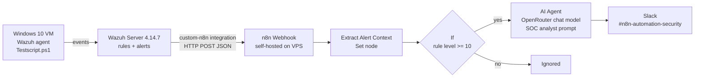
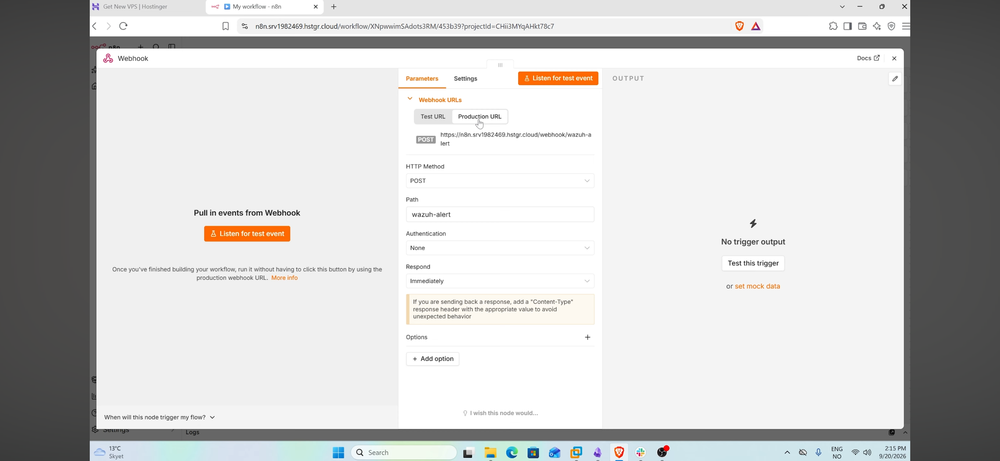
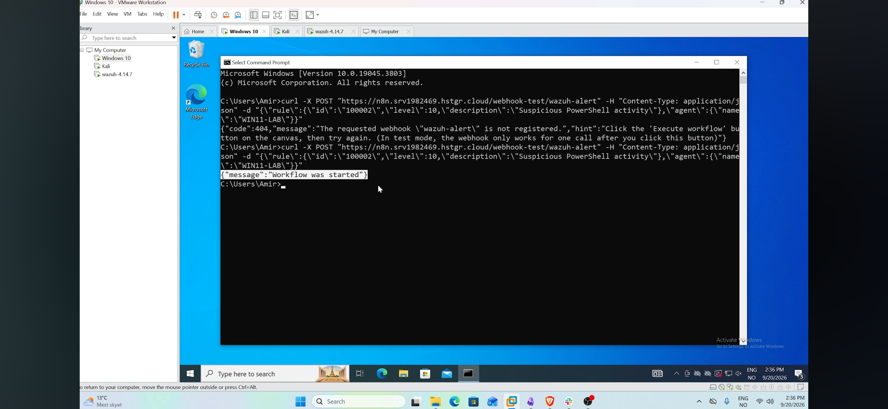
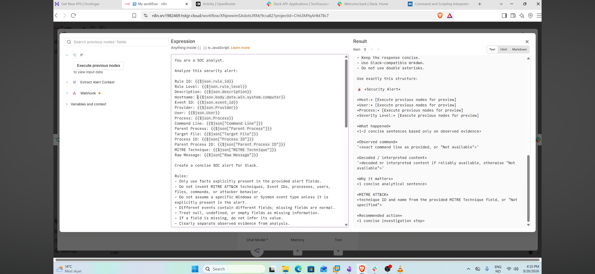
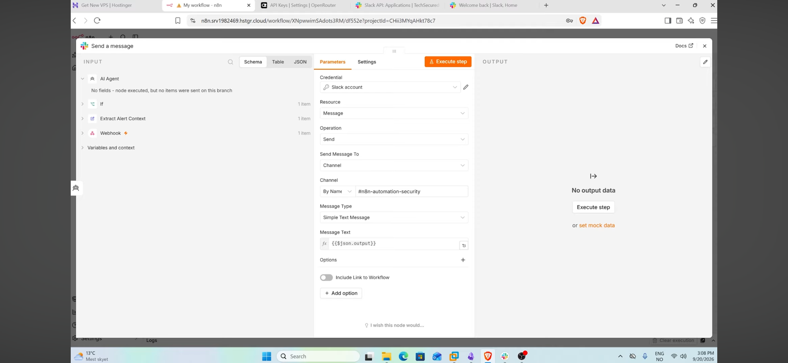
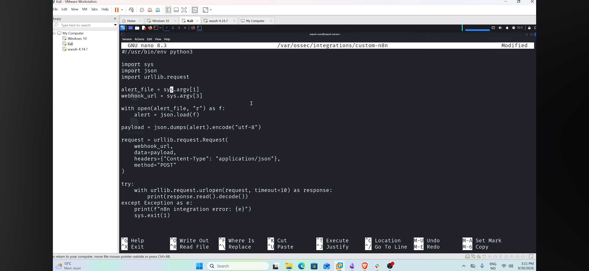
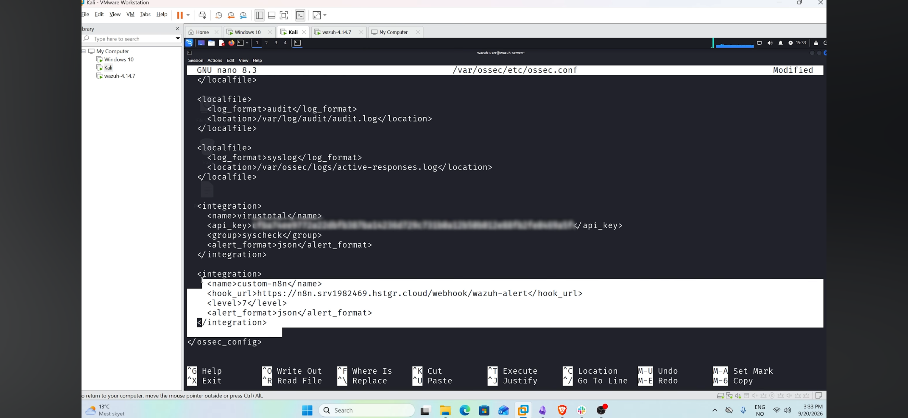
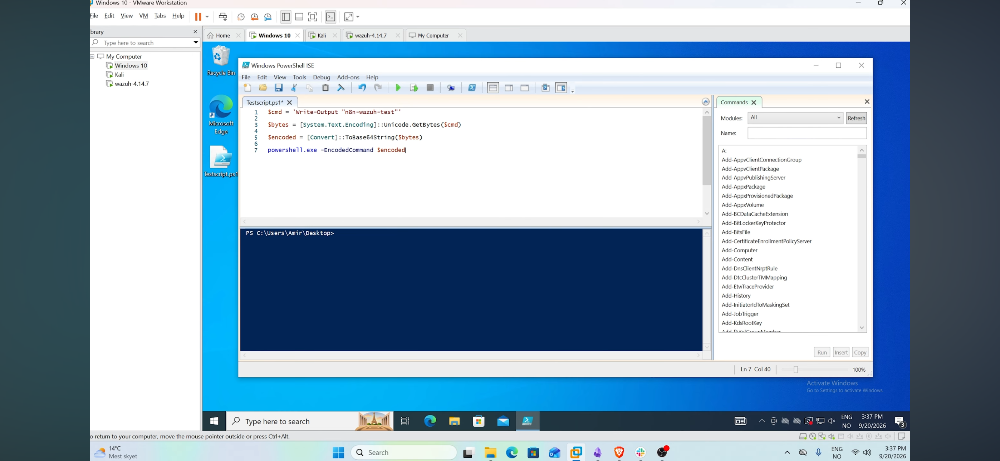
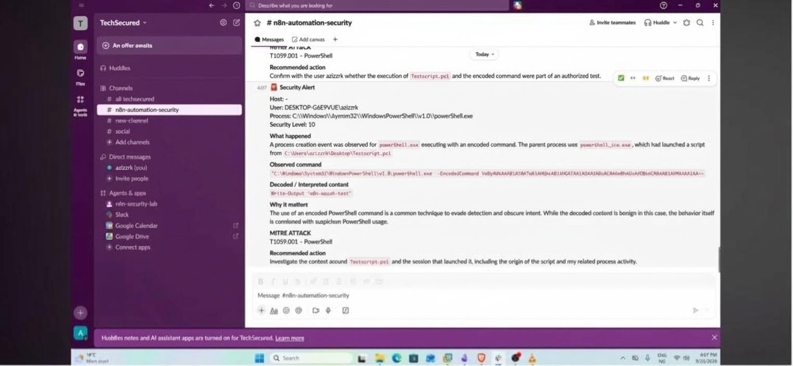
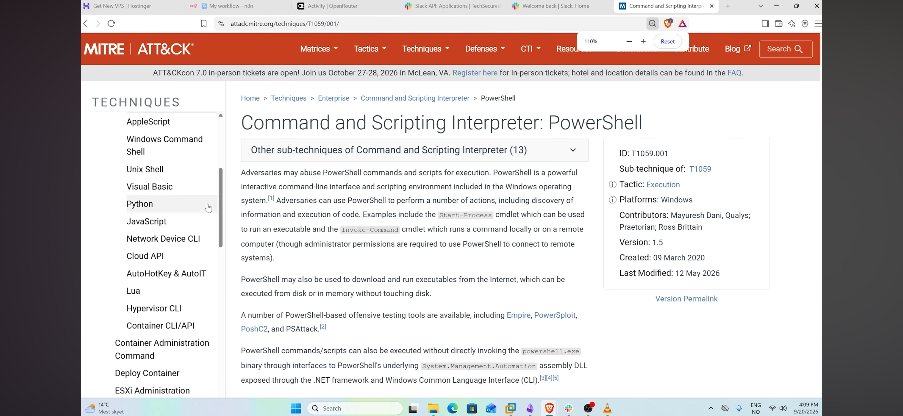

# Wazuh → n8n → AI → Slack: Automated SOC Alert Triage Lab

A home-lab project where **Wazuh** security alerts are automatically sent to an **n8n** workflow, analysed by an **LLM acting as a SOC analyst**, and delivered as a clean, structured message in **Slack**.

> Author: Aziz Zarrouk, Computer Science Engineering student (ESPRIT), interested in cybersecurity and automation.
> GitHub: [Az1zzr](https://github.com/Az1zzr)

---

## 1. Goal

When an analyst gets a raw Wazuh alert (a big JSON blob), they still have to read it, understand it, map it to MITRE ATT&CK and decide what to do. I wanted to automate that first step:

1. Wazuh detects something suspicious on an endpoint.
2. The alert is forwarded to n8n through a webhook.
3. Only alerts above a severity threshold go to the AI.
4. The AI writes a short, evidence-based SOC summary.
5. The summary is posted to a Slack channel.

## 2. Architecture



| Component | Role |
|---|---|
| VMware Workstation | Hosts the lab VMs |
| Windows 10 VM | Monitored endpoint, runs the test script |
| Wazuh server 4.14.7 VM | SIEM / detection, runs the custom integration |
| Kali VM | Used as a terminal to administer the Wazuh server |
| n8n (self-hosted on a Hostinger VPS) | Workflow automation |
| OpenRouter (`deepseek/deepseek-v4-flash`) | LLM provider |
| Slack | Alert delivery |

## 3. Repository structure

```
.
├── README.md
├── integration/
│   ├── custom-n8n                  # Wazuh integration script (Python)
│   └── ossec-integration-block.xml # Block added to ossec.conf
├── testing/
│   ├── Testscript.ps1              # Encoded PowerShell test (runs on the Windows VM)
│   └── mock-alert.sh               # Fake alert to test the webhook alone
└── screenshots/                    # 7 numbered screenshots used below
```

## 4. Setup, step by step

### Step 1: Create the n8n webhook

In n8n I added a **Webhook** node:

- HTTP method: `POST`
- Path: `wazuh-alert`
- Respond: `Immediately`

n8n gives two URLs: a **Test URL** (`/webhook-test/...`) and a **Production URL** (`/webhook/...`). The Wazuh integration uses the production one.


*Screenshot 1: Webhook node configured with POST and the path `wazuh-alert`, with the Production URL selected.*

### Step 2: Test the webhook with a fake alert

Before touching Wazuh, I checked the n8n side by sending a mock alert with `curl` from the Windows VM (see `testing/mock-alert.sh`).

The first call returned a `404` ("webhook not registered"), because in test mode the webhook only listens **once, after clicking Execute workflow / Listen for test event**. After clicking it, the second call returned `{"message":"Workflow was started"}`.


*Screenshot 2: First call gives 404 (not listening), second call returns "Workflow was started".*

### Step 3: Extract the useful fields (Set node "Extract Alert Context")

The raw Wazuh alert is large, so a **Set** node keeps only what the AI needs: rule id, rule level, description, event id, provider, user, process, command line, parent process, target file, process ids, MITRE technique and raw message. Expressions look like `{{ $json.body.rule.description }}`.

Fields that don't exist in a given alert come out as `undefined`. That is normal, since different event types contain different fields, and the prompt is written to handle it.

### Step 4: Filter by severity (If node)

An **If** node keeps only alerts where `rule.level >= 10`. Lower-level noise never reaches the AI, which saves API cost and avoids flooding Slack.

### Step 5: AI analysis (AI Agent + OpenRouter)

An **AI Agent** node uses an **OpenRouter Chat Model** (`deepseek/deepseek-v4-flash`) with a SOC analyst prompt. The important design choices in the prompt:

- Use **only facts present in the alert fields**.
- Do **not invent** MITRE techniques, event IDs, processes, users or commands.
- Treat null / undefined / empty fields as **missing information**, never infer them.
- Clearly separate **observed evidence** from **analysis**.
- Output a fixed Slack-friendly (mrkdwn) structure: Host, User, Process, Severity, What happened, Observed command, Decoded content, Why it matters, MITRE ATT&CK, Recommended action.


*Screenshot 3: The prompt expression in n8n (left) and the output template preview (right).*

### Step 6: Send to Slack

A **Slack → Send a message** node posts `{{ $json.output }}` (the AI result) to the channel `#n8n-automation-security`. The Slack app uses a bot access token and a signing secret stored as an n8n credential (never committed to this repo).


### Step 7: The Wazuh integration script

Wazuh runs custom integrations from `/var/ossec/integrations/`. I created `custom-n8n`, a small Python script that reads the alert file Wazuh gives it and POSTs the JSON to the webhook:

```bash
sudo nano /var/ossec/integrations/custom-n8n
```

Wazuh calls the script with `<alert_file> <api_key> <hook_url>`, so the script reads `sys.argv[1]` (alert file) and `sys.argv[3]` (hook URL). Full code: [`integration/custom-n8n`](integration/custom-n8n).


*Screenshot 4: The `custom-n8n` script open in nano on the Wazuh server.*

### Step 8: Permissions

Wazuh only executes integration scripts that are owned by `root` with group `wazuh`, and not world-accessible:

```bash
sudo chmod 750 /var/ossec/integrations/custom-n8n
sudo chown root:wazuh /var/ossec/integrations/custom-n8n
```

### Step 9: Register the integration in `ossec.conf`

In `/var/ossec/etc/ossec.conf` I added an `<integration>` block just before `</ossec_config>` (template: [`integration/ossec-integration-block.xml`](integration/ossec-integration-block.xml)):

```xml
<integration>
  <name>custom-n8n</name>
  <hook_url>https://the-n8n-domain/webhook/wazuh-alert</hook_url>
  <level>7</level>
  <alert_format>json</alert_format>
</integration>
```

I restarted afterwards (`sudo systemctl restart wazuh-manager`).


*Screenshot 5: The new `custom-n8n` integration block in `ossec.conf`, next to the existing VirusTotal integration .

## 5. Testing

To generate a realistic alert I wrote a harmless script, [`testing/Testscript.ps1`](testing/Testscript.ps1), that runs a command through **PowerShell `-EncodedCommand`** (Base64 of a UTF-16LE string). Encoded commands are a common obfuscation technique (MITRE **T1059.001 – Command and Scripting Interpreter: PowerShell**), so they are a good thing for a SIEM to flag, while the payload here is only `Write-Output "n8n-wazuh-test"`.

```powershell
$cmd = 'Write-Output "n8n-wazuh-test"'
$bytes = [System.Text.Encoding]::Unicode.GetBytes($cmd)
$encoded = [Convert]::ToBase64String($bytes)
powershell.exe -EncodedCommand $encoded
```

I ran it in PowerShell ISE on the Windows 10 VM.


`Testscript.ps1` in PowerShell ISE on the Windows VM.*

## 6. Results

The full chain worked end to end: the encoded PowerShell command was detected, forwarded by Wazuh to n8n, summarised by the AI and posted in Slack with:

- the process and user involved,
- the observed command line and its **decoded** content,
- why it matters (encoded commands are used to hide intent, but the decoded content here is benign),
- the MITRE technique **T1059.001 – PowerShell**,
- a recommended action (confirm with the user whether the script was an authorised test).


The final AI-generated "Security Alert" in the `#n8n-automation-security` Slack channel.*

I also checked the technique ID against the official MITRE ATT&CK page for T1059.001 to confirm the AI's mapping was right.

## 7. Lessons learned

1. **Test each hop separately.** Testing n8n with `curl` first made it easy to know the problem was not on the Wazuh side.
2. **Test URL vs Production URL.** The test webhook only listens for one call after you click "Listen". The Wazuh integration must use the production URL and the workflow must be **active**.
3. **Prompt guardrails matter.** Without "only use provided facts / don't invent", LLMs happily make up MITRE techniques or event IDs. Telling the model that missing fields are normal gave much more trustworthy output.
4. **Not every alert has every field.** My field mappings returned `undefined` for some Windows event fields, and the Slack message showed `Host: -`. The hostname/user paths differ per event type, so the extraction needs to be checked against real alerts, not only mock ones.
5. **Two thresholds.** Wazuh forwards level ≥ 7, n8n only processes level ≥ 10. It is a simple but effective way to control noise and cost.
6. **File permissions are part of the integration.** A wrong owner or mode on `custom-n8n` means Wazuh silently refuses to run it.
7. **Secrets hygiene.** API keys, Slack tokens and signing secrets live in n8n credentials / `ossec.conf` and must never be pushed to GitHub (I blurred the VirusTotal key in a screenshot).

## 8. Limitations and next steps

- Add retries/error handling in n8n if the LLM or Slack is unavailable.
- alerts (IP reputation, file hashes) before the AI step.
- Add more detection use cases (brute force, new admin user, suspicious network connections).


make sure the company you work for allow you sharing the data to the llm

